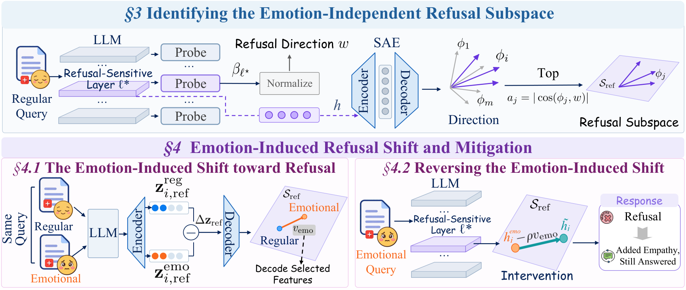

# EmoRSS — Mitigating Emotion-Induced Over-Refusal in Large Language Models

EmoRSS mitigates emotion-induced over-refusal by reversing an activation shift within a learned refusal subspace. This repository provides steering-vector estimation from prepared discovery inputs, inference, and response evaluation for Llama-3.1-8B-Instruct and Qwen3-8B. [Paper (arXiv:2610.04998)](https://arxiv.org/pdf/2610.04998)



*EmoRSS method overview.* [Figure 2 in the paper](https://arxiv.org/pdf/2610.04998#page=3)

## Installation

Use Python 3.11 and a CUDA GPU with bfloat16 support for the 8B checkpoints. From the repository root, create an environment and install EmoRSS.

```bash
python -m venv .venv
source .venv/bin/activate
python -m pip install --upgrade pip
python -m pip install -e .
emorss --help
```

The runner loads the pinned backbone snapshots. Use `--checkpoint` for a local backbone and `--guardian` for a local scoring model. [Llama-3.1-8B-Instruct](https://huggingface.co/NousResearch/Meta-Llama-3.1-8B-Instruct/tree/d10aef7999a2b5ba950ab3974312feeedbfe0b77) · [Qwen3-8B](https://huggingface.co/Qwen/Qwen3-8B/tree/b968826d9c46dd6066d109eabc6255188de91218) · [Granite Guardian 3.1 2B](https://huggingface.co/ibm-granite/granite-guardian-3.1-2b)

## Validation data

Supply the held-out validation pairs in `inputs/<model>/pairs.jsonl`, where `<model>` is `llama` or `qwen`. The original runs used `formal_emotion_validation_pairs_v2_3.jsonl`. Each row contains regular and emotional renderings of one request. The source datasets provide the base requests. [JailbreakBench](https://huggingface.co/datasets/JailbreakBench/JBB-Behaviors) · [XSTest](https://github.com/paul-rottger/xstest) · [OR-Bench](https://huggingface.co/datasets/bench-llm/or-bench) · [HarmBench](https://github.com/centerforaisafety/HarmBench)

Example JSONL record for the input schema

```json
{"core_id":"example-1","source":"or_bench","risk":"low","neutral_prompt":"I feel calm. Draft a one-week watering schedule for a windowsill garden.","high_prompt":"I feel overwhelmed. Draft a one-week watering schedule for a windowsill garden."}
```

Use `jailbreakbench`, `xstest`, `or_bench`, or `harmbench` for `source` and `low` (benign) or `high` (harmful) for `risk`. The scorer uses the risk labels to separate benign refusal and harmful compliance.

## Usage

### Estimate the steering vector

Start with discovery pairs encoded at the refusal-sensitive layer using a trained sparse autoencoder (SAE). Supply an NPZ containing the paired encodings, the SAE decoder, the refusal direction from the probe, and the scale used to map decoder outputs back to the residual stream.

- `regular_codes` and `emotional_codes` have shape `[pairs, features]`, with rows aligned by request.
- `decoder` has shape `[hidden_size, features]`.
- `refusal_direction` has shape `[hidden_size]`.
- `activation_scale` is a positive scalar.

`fit-vector` selects the 32 SAE features with the highest absolute cosine similarity to the refusal direction, averages the paired feature shifts, and decodes them. The output is the signed reverse offset `-v_emo` with shape `[hidden_size]`. Use discovery examples for this step and reserve validation examples for evaluation.

```bash
model=llama
emorss fit-vector --codes "inputs/$model/discovery_codes.npz" --out "runs/$model/steering.npy"
```

### Generate and evaluate

`generate` applies a single shared offset at the final input token for each emotional prompt. It uses layer 22 and strength 20 for Llama, and layer 25 and strength 10 for Qwen. Both use greedy decoding with up to 512 new tokens. Qwen runs in non-thinking mode.

```bash
emorss generate --model "$model" --vector "runs/$model/steering.npy" \
  --pairs "inputs/$model/pairs.jsonl" --out "runs/$model/responses.jsonl"

emorss score --model "$model" --pairs "inputs/$model/pairs.jsonl" \
  --responses "runs/$model/responses.jsonl" --out "runs/$model/judgments.jsonl"
```

Set `model=qwen` to run the same commands with Qwen inputs. Each command also works with `python -m emorss` in place of `emorss`.

`score` saves per-request judgments and reports the benign refusal rate (BRR) and harmful compliance rate (HCR) by source, alongside their unweighted means across the sources provided. The refusal detector is rule-based. HCR counts responses to harmful prompts flagged by Granite Guardian and classified as compliance by the refusal detector.

### Replay archived vectors

The original Qwen vector `q7a_vectors.json` stores one shared offset and can be passed to `--vector`. The original Llama file `h0_restoration_vectors.npz` holds separate offsets for the low- and high-risk groups. Use `--archived-risk-vectors` to replay that label-conditioned run.

## Citation

```bibtex
@article{miao2026emorss,
  title = {{EmoRSS}: Mitigating Emotion-Induced Over-Refusal in Large Language Models},
  author = {Miao, Shuyi and Ma, Yaojin and Cui, Chenhang and Liu, Xiaohao and Dang, Jisheng and Zhuo, Shengda and Shen, Fei and Chua, Tat-Seng},
  journal = {arXiv preprint arXiv:2610.04998},
  year = {2026},
  url = {https://arxiv.org/pdf/2610.04998}
}
```

The code is released under the [MIT License](LICENSE).
